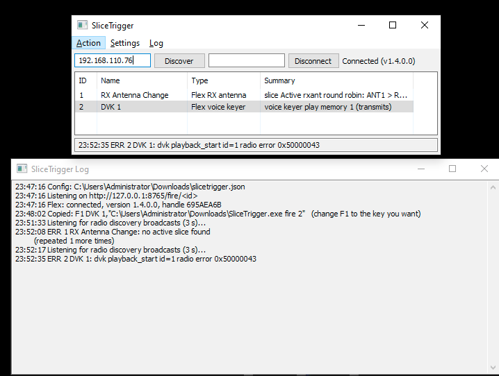

# SliceTrigger


Lets N1MM Logger+ function keys trigger actions on devices N1MM cannot control
via CAT. One key press can:

- switch the FlexRadio receive antenna of the active slice, or cycle
  ANT1 > RX_A > RX_B > back to ANT1
- play a FlexRadio voice keyer (DVK) memory, with ESC to stop it
- send raw SmartSDR API commands
- switch KMtronic WEB relays
- send an HTTP GET or raw TCP data to any other device



*Main window (top) and the separate log window. Screenshot from an earlier
build; the current one adds a green/amber/grey connection light and shows
the radio's name next to it.*

## Download

Download `SliceTrigger.exe` from the
[latest release](https://github.com/va3mw/SliceTrigger/releases/latest) (the
same file is also in this repository). It is a ready-to-run Windows x64 build;
no installer and no runtime are needed.

## Quick start

1. Copy `SliceTrigger.exe` to a path **without spaces**, e.g. `C:\Ham\SliceTrigger.exe`, and start it.
   Leave it running while you operate; the function keys talk to the running instance.
2. Enter the radio IP (or click **Discover**), leave **Station** empty (see [Not yet supported](#not-yet-supported)), and click **Connect**.
   The light turns green and the radio's name appears when connected. Start SmartSDR first; if actions
   report "no active slice" right after connecting, click Disconnect and Connect again.
3. Recommended: **Settings > Install .exe in %APPDATA%** copies SliceTrigger and your settings to
   `%APPDATA%\SliceTrigger`, creates a desktop shortcut and restarts from there. Then use
   **Copy N1MM macro** again so your function keys point to the installed copy. (If your Windows user
   name contains a space, the path will too, and N1MM cannot run it; use a folder like `C:\Ham` instead.)
   **Settings > Create desktop shortcut** on its own just adds the shortcut.
4. Use **Action > Add** to create actions and check each one with **Action > Test**. The bottom line shows `OK` or the error.

The main window is deliberately small so it can stay on screen while you
operate. The light next to Connect is green when connected (with the radio's
name and model beside it), amber while connecting or reconnecting, and grey
when disconnected. The window title and taskbar icon follow it, so the state
is visible from the taskbar too. Add, edit, duplicate, delete, test and "Copy N1MM macro" are in the
**Action** menu and on the right-click menu of the action list; double-click an
action to edit it. The trigger port is under **Settings**. **Log** opens the
full log in a separate window you can park on another screen; the line at the
bottom of the main window shows the latest message. Identical consecutive
messages are logged once, with a repeat count.

## Updates

**Help > Check for updates** compares your version with the one on GitHub
(`VERSION` in this repository). If a newer one exists it offers to download it
into the folder SliceTrigger is running from, checks the download against the
published SHA-256, swaps it in and restarts. The previous exe is kept as
`SliceTrigger.exe.old` until the next start. SliceTrigger also checks once at
startup and notes an available update in the log; it never installs without
asking.

- The folder must be writable, so keep SliceTrigger somewhere like `C:\Ham`
  rather than Program Files.
- Named copies such as `SliceTrigger-fire-1.exe` are not updated; copy the new
  exe over them if you use them.
- Versions before 0.8.0 have no updater: download 0.8.0 by hand once.

## N1MM Logger+ setup

1. In SliceTrigger select an action and choose **Action > Copy N1MM macro** (or right-click it). The clipboard now holds a line like:

   ```
   F1 Ant2,"C:\Ham\SliceTrigger.exe fire 3"
   ```

2. In N1MM open the function key editor (Config > Change CW/SSB/Digital Function Key Definitions,
   or right-click a function key button in the Entry Window).
3. Paste the line and change `F1` to the key you want. The text before the comma is the button label.
4. Add the line to both the Run and the S&P section, and to the key file of each mode (CW, SSB, Digital) you use.
5. Save and press the key. The bottom line of SliceTrigger shows the action firing.

Use `fire 3,5` to run several actions from one key. If a key does nothing, run
`C:\Ham\SliceTrigger.exe fire 3` from a Command Prompt: if SliceTrigger shows the
action, the bridge is fine and the N1MM line needs adjusting.

## If the function key opens a second SliceTrigger window

If pressing the key shows "Cannot listen on 127.0.0.1:8765 ... Is SliceTrigger
already running?", the logger started the exe without a usable `fire`
argument. The message box shows the arguments that copy received. Two
workarounds that do not depend on arguments being passed:

- **Named copy:** copy the exe to `SliceTrigger-fire-1.exe` (same folder) and
  put that in the function key line. A copy named `...-fire-<id>.exe` fires
  that action and exits. Use `-fire-3,5` for several.
- **Batch file:** create `fire1.bat` containing
  `start "" "C:\Ham\SliceTrigger.exe" fire 1` and put the .bat in the function
  key line (a console window flashes briefly).

## Trigger port

The **Trigger port** (default 8765) is the local port the running SliceTrigger
window listens on for "fire" requests. You can normally leave it alone.

When N1MM runs `SliceTrigger.exe fire 1`, that second copy of the exe does not
talk to the radio. It sends a request to the already-running window at
`http://127.0.0.1:8765/fire/1` and exits. The running window, which keeps the
connection to the radio open, carries out the action. That is why a key press
is fast, and why SliceTrigger must be running while you operate.

- It only accepts connections from the same PC (127.0.0.1); nothing else on
  your network can reach it.
- Change it only if another program already uses 8765. SliceTrigger shows
  "Cannot listen on 127.0.0.1:8765" at startup when that happens. Set a new
  port under **Settings > Trigger port**.
- The `fire` command reads the port from the same config file, so your N1MM
  lines do not need editing after a change.

## Trigger interface

The running instance answers these requests on that port:

| Request | Effect |
|---|---|
| `GET /fire/3` | run action 3 |
| `GET /fire/3,5` | run actions 3 then 5 |
| `GET /fire/Ant2` | run the action named "Ant2" (case-insensitive) |
| `GET /` | list actions |

`SliceTrigger.exe fire 3`, `fire 3 5`, `fire 3,5` and `fire -port 9000 3` send the
request to the running instance and exit (exit code 0 = all actions succeeded).
The reply is 200 if everything succeeded, 404 for an unknown action, 500 if an action failed.

## Action types

| Type | What is sent |
|---|---|
| Flex RX antenna | `slice set <index> rxant=<ant>`; slice A..H or Active. Fixed antenna, or a cycle out to the antennas you tick and back to ANT1/ANT2 |
| Flex raw command | one or more API commands separated by `;`, `{slice}` = resolved slice index; stops at the first error |
| Flex voice keyer | play voice keyer (DVK) memory 1–12 (`dvk playback_start id=N`, **keys the transmitter**), or stop playback |
| KMtronic relay | `http://<ip>/FF0101` on, `FF0100` off, `FFE0xx` pattern (bit 0 = relay 1), `FFE000` all off |
| HTTP GET | any URL, optional basic auth |
| TCP send | bytes to `host:port`, escapes `\r \n \t \0 \\ \xHH`, optional reply read |

Slice resolution: "Active" is the slice reporting `active=1` (the one selected
in SmartSDR), never the TX slice. With a Station set, only slices owned by that
SmartSDR client are considered. Without one, "Active" fails if more than one
client has an active slice, and a letter picks the lowest-numbered match. The
Station filter is groundwork for multiFLEX, which is not yet tested or
supported.

RX antenna cycle (the default for a new RX antenna action): tick "Cycle" and
the antennas to switch to, e.g. RX_A and RX_B. The slice's main antenna, ANT1
or ANT2, is home. Each press moves to the next ticked antenna, and the press
after the last one returns home:

    ANT1 > RX_A > RX_B > ANT1 > ...

- Home is whichever of ANT1/ANT2 the slice is on when the cycle starts. If you
  change the slice to ANT1 or ANT2 in SmartSDR, that becomes the new home.
- If the slice is on a receive-only antenna and SliceTrigger has no home yet,
  it uses the slice's TX antenna (if ANT1/ANT2), otherwise ANT1.
- Any antenna can be ticked, including XVTA/XVTB and the other main antenna
  (ticking ANT2 with home ANT1 gives ANT1 > ANT2 > ... > ANT1).
- From an antenna that is not part of the cycle, a press returns home.
- Antennas the radio does not list for that slice (`ant_list`) are skipped.
- Only the receive antenna changes; the TX antenna is never touched.

## Voice keyer (DVK)

A **Flex voice keyer** action plays one of the radio's 12 DVK memories, the
same ones as the SmartSDR DVK panel. Playback keys the transmitter. Record and
name the memories in SmartSDR; SliceTrigger only plays and stops them. The
radio's voice keyer needs SmartSDR v4 or later (and, per AetherSDR, the
SmartSDR+ entitlement); a radio without it rejects the command and the error
appears in the log. **Action > Test** on a play action asks before transmitting.

**ESC stops playback.** With **Settings > ESC stops voice keyer playback**
ticked (the default), pressing ESC in any program, N1MM included, stops a
playing memory. N1MM still receives the ESC, so it also stops its own keying as
usual. ESC does nothing while the voice keyer is idle, and never interrupts a
recording. If the radio reports no voice keyer status, ESC only stops a memory
SliceTrigger itself started.

A "Stop playback" action does the same from a function key.

## Config

`slicetrigger.json` next to the exe if that folder is writable, otherwise
`%APPDATA%\SliceTrigger\slicetrigger.json`. The path is shown in the log window.
Relay/HTTP passwords are stored there in plain text.

## Build

Windows: `build.bat`. macOS/Linux cross-compile: `./build.sh`.

Both generate the icon (`tools/mkicon` writes `assets/slicetrigger.ico` and
`docs/icon.png`), run `rsrc` to produce `rsrc_windows_amd64.syso` from the icon
and `slicetrigger.manifest` (common controls v6 — walk crashes at startup
without it), build with `-ldflags "-H windowsgui"`, and write `VERSION` (the
version from `version.go` and the exe's SHA-256).

**Releasing:** bump `Version` in `version.go`, run the build, and commit
`SliceTrigger.exe` and `VERSION` together. "Check for updates" only offers a
build whose version is higher than the running one.

Tests (any OS): `go test -race .` — includes a mock Flex radio on a local TCP port.
On non-Windows systems `go build` produces a headless build (no GUI) for development.

## Files

| File | Contents |
|---|---|
| `flex.go` | Flex TCP API client: handshake, command/reply, status merge, slice resolution, reconnect |
| `discovery.go`, `reuse_*.go` | UDP 4992 discovery listener with `SO_REUSEADDR` |
| `actions.go` | action model, RX antenna cycle, voice keyer, KMtronic/HTTP/TCP senders, `Bridge.Fire` |
| `server.go` | HTTP trigger listener and `fire` client |
| `config.go` | config location, load, save |
| `main.go` | entry point, `fire` client mode and named-copy detection |
| `version.go`, `VERSION` | release version; `VERSION` also holds the exe's SHA-256 for the updater |
| `update.go` | update check, download, checksum, swap |
| `install.go` | install to `%APPDATA%\SliceTrigger` |
| `shortcut_windows.go` | desktop shortcut |
| `internal/sticon`, `tools/mkicon` | the ST icon (drawn in code) and its generator |
| `assets/` | generated `.ico` |
| `gui_windows.go` | walk GUI: main window, log window, edit dialog, status light |
| `eschook_windows.go` | system-wide ESC key hook for stopping the voice keyer |
| `app_other.go` | headless entry point for non-Windows |
| `core_test.go` | unit tests, including the mock Flex radio |
| `docs/` | README images, including the icon |

## Status

Early, but in use. Confirmed on a FLEX-8600 with N1MM Logger+: function keys
firing actions through the `fire` command, RX antenna changes on the active
slice, and voice keyer playback.

Not yet confirmed on real hardware: the ANT1/ANT2 return cycle, ESC stopping
the voice keyer, the connection light, discovery, and KMtronic relays. The core
is covered by unit tests against a mock radio.

### Not yet supported

- **multiFLEX** (two or more SmartSDR clients on one radio) is not tested or
  supported. SliceTrigger has a Station filter for it, but it has never been
  tried with a second client. Support may come in a future version; until then,
  use SliceTrigger with a single SmartSDR client and leave Station empty.
- **Diversity reception** is not yet tested. RX antenna and other slice actions
  have not been tried on a slice in diversity mode, so behaviour there is
  unknown.

## Protocol assumptions

These come from general knowledge of the SmartSDR TCP/IP API and from other
open-source Flex clients, not from FlexRadio documentation:

- The `info` reply is comma separated `key=value` pairs including `name=` (nickname) and `model=` (format as parsed by AetherSDR).
- Station names in `client` status lines encode spaces as `0x7F`; they are decoded before comparing.
- A slice is dropped from the table on `in_use=0`, a client on `client <handle> disconnected`.
- Slices are matched to a station by comparing the slice's `client_handle` with the handle in `client 0x<handle> connected ... station=<name>`.
- A `ping` command is sent every 10 s as keepalive; only a *missing* reply (5 s) drops the connection, an error reply does not.
- Slice status carries the current RX antenna as `rxant=`, the TX antenna as `txant=`, and the selectable ones as a comma separated `ant_list=`.
- Voice keyer, taken from two open-source Flex clients rather than FlexRadio documentation
  ([AetherSDR](https://github.com/aethersdr/AetherSDR) `src/models/DvkModel.cpp`,
  [kgbvax/StationA](https://github.com/kgbvax/StationA) `flexbridge/internal/flexradio/client.go`):
  12 memories; `sub dvk all`; play `dvk playback_start id=N`; stop `dvk playback_stop`
  (AetherSDR's form, without an id; StationA adds `id=N`); `dvk preview_stop` for preview;
  status lines `dvk status=idle|recording|preview|playback|disabled [id=N] enabled=0|1`.
- Firmware that does not report `index_letter` falls back to A=0, B=1, ...

## License

MIT, see [LICENSE](LICENSE).
